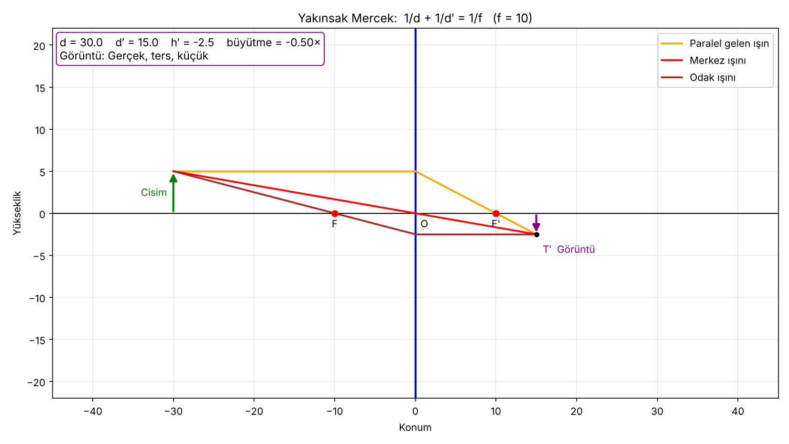
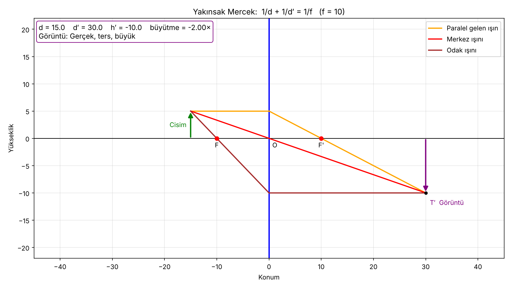
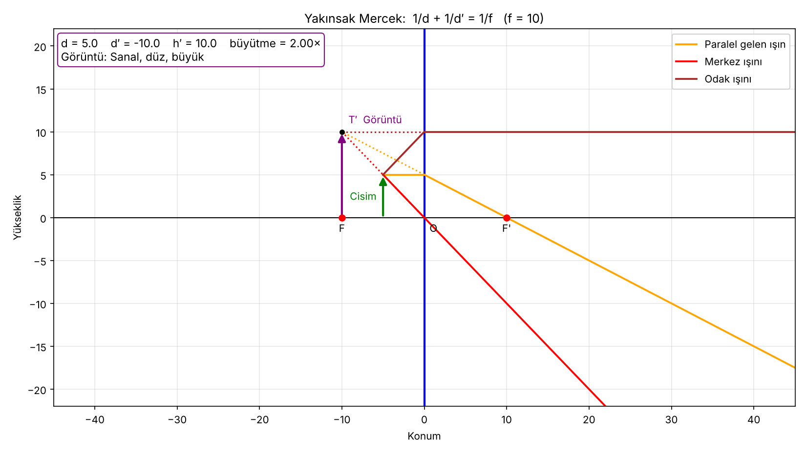

# Yakınsak Mercek Simülasyonu

Python ve Matplotlib ile yazılmış, yakınsak (ince kenarlı) bir merceğin oluşturduğu görüntüyü ışın diyagramıyla gösteren küçük bir simülasyon. Cisim merceğe yaklaştıkça görüntünün büyümesini, odak noktasında kaybolmasını ve odağın içinde **sanal** görüntüye dönüşmesini canlı izlemek için hazırlandı.

Medikal Görüntü İşleme dersi, mikroskop konusu için yapılmıştır: mikroskobun objektifi ve okülerinin neden farklı bölgelerde çalıştığını göstermek amaçlanır.

## Neler yapar?

- Yakınsak mercek, odak noktaları (F, F′) ve ok şeklinde cismi çizer.
- Üç temel ışını çizer: eksene paralel gelen, merceğin merkezinden geçen ve odaktan geçen ışın.
- Görüntü konumunu (`d′`) ve boyunu (`h′`) ince mercek denklemiyle hesaplar.
- Görüntü türünü yazar: gerçek/sanal, ters/düz, büyük/küçük.
- Gerçek görüntüde ışınlar görüntü ucunda birleşir; sanal görüntüde ışınların noktalı geriye uzantıları görüntü ucunda kesişir.

## Kurulum

```bash
pip install -r requirements.txt
```

## Çalıştırma

Kaydırma çubuğuyla cismin uzaklığı `d` canlı değiştirilir:

```bash
python mercek_slider.py
```

## Fizik

Odak uzaklığı `f = 10`, cisim yüksekliği `h = 5` alınmıştır.

```
1/d + 1/d′ = 1/f          →   d′ = 1 / (1/f − 1/d)
h′ = −(d′ / d) · h
```

- `d′ > 0`: görüntü gerçek, merceğin karşı tarafında oluşur.
- `d′ < 0`: görüntü sanal, cisimle aynı taraftadır.
- `h′ < 0`: görüntü ters; `h′ > 0`: düz.
- `d = f` noktasında `d′` sonsuza gider; çıkan ışınlar paraleldir ve görüntü oluşmaz. Simülasyon bu durumu ayrıca gösterir.

## Ekran görüntüleri

| `d = 30` | `d = 15` | `d = 5` |
|---|---|---|
|  |  |  |

## Dosyalar

- `mercek_slider.py`: Kaydırma çubuklu interaktif simülasyon.
- `ornekler/`: Örnek çıktılar.
